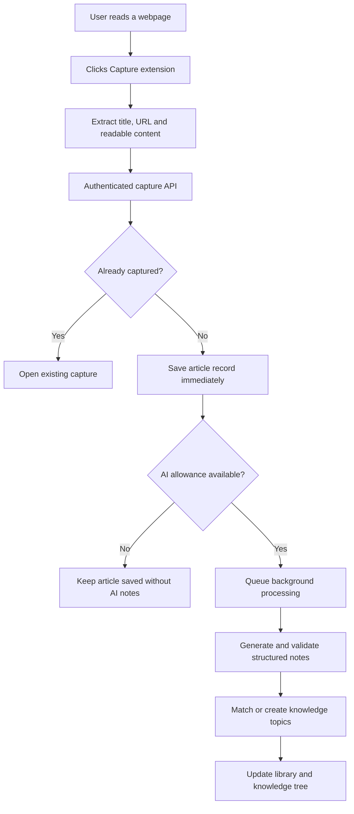
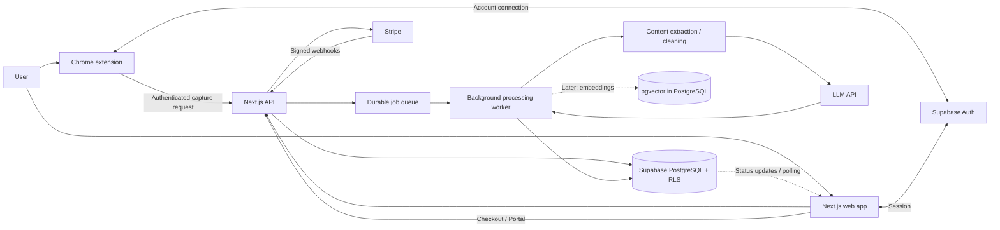
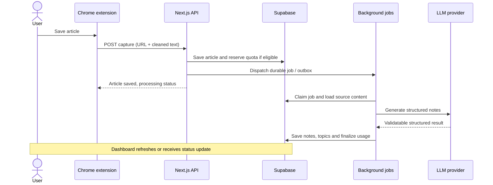
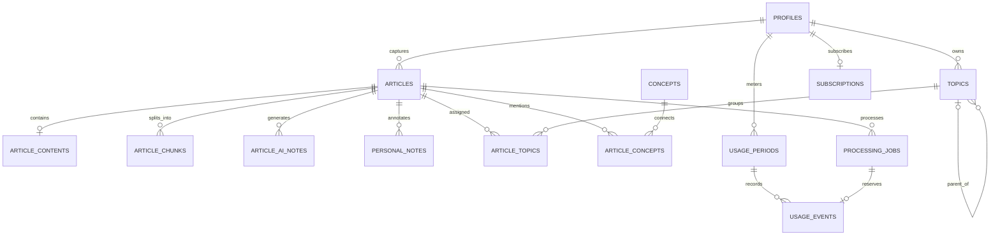
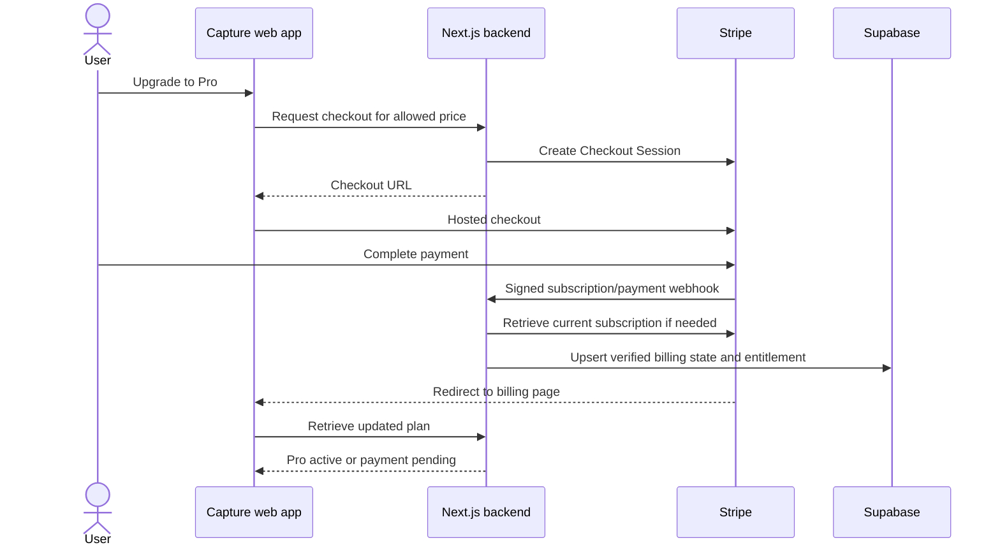

# Capture — Personal Knowledge Capture & Organization Platform

> Capture what you learn. Connect what you know.

**Document type:** Product concept, requirements, business model, and technical architecture  
**Status:** Proposed MVP specification  
**Last updated:** 21 November 2026  
**Product name:** Capture (working name)  
**Platform:** Chrome extension + web application  
**Business model:** Freemium SaaS

---

## Table of Contents

1. [Executive Summary](#1-executive-summary)
2. [Problem Statement](#2-problem-statement)
3. [Target Users](#3-target-users)
4. [Product Vision and Positioning](#4-product-vision-and-positioning)
5. [Product Components](#5-product-components)
6. [User Journey and Core Workflows](#6-user-journey-and-core-workflows)
7. [Feature Requirements](#7-feature-requirements)
8. [Knowledge Organization and AI Engine](#8-knowledge-organization-and-ai-engine)
9. [UI and Navigation](#9-ui-and-navigation)
10. [Free and Pro Plans](#10-free-and-pro-plans)
11. [Technical Architecture](#11-technical-architecture)
12. [Capture and Processing Pipeline](#12-capture-and-processing-pipeline)
13. [Database Design](#13-database-design)
14. [API Design](#14-api-design)
15. [Authentication, Security and Privacy](#15-authentication-security-and-privacy)
16. [Payments and Usage Management](#16-payments-and-usage-management)
17. [Repository Structure](#17-repository-structure)
18. [MVP Scope and Roadmap](#18-mvp-scope-and-roadmap)
19. [Testing and Acceptance Criteria](#19-testing-and-acceptance-criteria)
20. [Business Viability and Distribution](#20-business-viability-and-distribution)
21. [Risks and Mitigation](#21-risks-and-mitigation)
22. [Success Metrics](#22-success-metrics)
23. [Key Decisions and Open Questions](#23-key-decisions-and-open-questions)

---

## 1. Executive Summary

Capture is an AI-powered personal knowledge management platform that allows users to save, understand, organize, and revisit information encountered while browsing the internet.

Users frequently discover useful articles, tutorials, documentation, research, and other educational resources online. However, storing these resources typically requires manually copying links, creating notes, assigning categories, and revisiting individual pages. Over time, this creates an unstructured collection of bookmarks, browser tabs, documents, and forgotten information.

Capture reduces this friction through a simple Chrome extension and a connected web application. When a user finds an article worth remembering, they click the extension and save it directly to their personal knowledge library. Capture then extracts the article's content, uses an LLM to generate structured notes, identifies the themes and concepts discussed, and organizes the information into a personalized knowledge tree.

The user does not need to manually decide which folder an article belongs in, write a summary, or connect the article with previously saved information. Capture proposes an organization automatically while allowing the user to correct it.

The core product loop is:

**Discover → Capture → Understand → Organize → Connect → Revisit**

Capture is not intended to be just another bookmarking service or article summarizer. Its long-term purpose is to transform the information users encounter online into a growing, searchable, interconnected knowledge base that reflects what they have been learning.

### 1.1 Product at a glance

| Component | Description |
|---|---|
| Chrome extension | One-click saving of the current webpage |
| Web application | Personal library, knowledge tree, article reader and AI-generated notes |
| AI processing engine | Content analysis, structured notes, key concepts, and categorization |
| Knowledge engine | Organizes captured articles and identifies relationships across sources |
| Subscription system | Free and Pro plans with monthly AI-processing quotas |
| Future learning engine | AI chat, synthesis, recommendations, and knowledge review |

## 2. Problem Statement

### 2.1 Fragmented knowledge

Information is scattered across bookmarks, open tabs, screenshots, messaging apps, research documents, and note-taking applications. Users often remember that they read something but cannot remember where they saw it.

### 2.2 High friction when capturing information

A conventional research workflow involves copying a URL, opening a notes application, creating a page, adding a title, selecting a category, writing notes, and repeating the process for every new resource. Each additional step makes it less likely that users will capture useful material consistently.

### 2.3 Saving information is not the same as learning

A bookmark preserves a reference but does not explain why it matters. Users accumulate reading lists they rarely revisit because retrieving useful ideas still requires opening and rereading each article.

### 2.4 Manual organization does not scale

As the user's library grows, manually creating folders, maintaining tags, and connecting related topics becomes progressively more demanding. Information may belong to multiple topics, and rigid folder hierarchies can make discovery difficult.

### 2.5 Core problem statement

> People continuously discover valuable information online, but the effort required to capture, organize, and revisit that information prevents it from becoming usable long-term knowledge.

### 2.6 Proposed solution

Capture combines low-friction content capture with automated note generation and knowledge organization. It maintains source links, helps users retrieve information, and makes relationships between captured resources visible without requiring an elaborate manual note-taking system.

## 3. Target Users

| Segment | Primary pain point | Capture use case |
|---|---|---|
| University and polytechnic students | Research and study materials are scattered | Build a subject-based knowledge tree from articles and tutorials |
| Developers and engineers | Useful technical references become difficult to find | Capture documentation, technical articles, and programming concepts |
| Founders and entrepreneurs | Market research and competitor insights are fragmented | Organize research by business, industry, market, or problem |
| Researchers and analysts | Many sources must be revisited and compared | Maintain source-linked notes and synthesize related information |
| Knowledge workers | Continuous learning competes with daily work | Capture useful professional knowledge without interrupting the workflow |
| Self-directed learners | Reading does not translate into retention | Build a personal learning library and revisit important concepts |

**Recommended initial audience:** students, developers, and self-directed learners who already save online resources frequently. These users have repeatable capture workflows, are accessible through online communities, and may benefit from the knowledge tree immediately.

### 3.1 Jobs to be done

- When I discover a useful article, I want to save it without leaving my current webpage.
- When I return to my research, I want to understand what I saved without rereading every source.
- When I learn something new, I want it automatically organized alongside relevant existing knowledge.
- When I forget where I read something, I want to retrieve it using a topic, keyword, or question.
- When I research a subject over time, I want to see how my understanding and sources connect.

## 4. Product Vision and Positioning

### 4.1 Vision

Become the personal knowledge layer between the open web and the user's long-term memory: a place where useful information is not only stored, but transformed into organized and retrievable knowledge.

### 4.2 Unique value proposition

**One click turns a useful webpage into a structured contribution to your personal knowledge base.**

### 4.3 Differentiation hypothesis

| Product category | Typical focus | Capture's proposed differentiation |
|---|---|---|
| Browser bookmarks and read-later apps | Save links and build reading lists | Turn saved content into automatically organized knowledge |
| Note-taking and PKM tools | Flexible manual writing, organization and linking | Minimize initial organization and note-taking effort |
| AI article summarizers | Summarize individual pages | Accumulate and organize knowledge across many sources |
| AI research assistants | Answer questions using selected sources | Build an ongoing personal library from everyday browsing |

These are category-level distinctions, not claims that specific competing products lack these capabilities. Capture's differentiation must be validated through user interviews and product testing.

### 4.4 Product principles

- Capture must remain faster than manually copying and pasting a URL.
- Saving must succeed even if AI processing is temporarily unavailable or a quota is exhausted.
- The knowledge tree must evolve from the user's captures rather than impose a fixed taxonomy.
- AI should organize by default; users must retain editorial control.
- Generated claims should be traceable to their original source where possible.
- User knowledge must remain accessible and exportable, including after subscription cancellation.
- Avoid building a general-purpose note editor, research chatbot, or complex graph platform before validating the capture loop.

## 5. Product Components

### 5.1 Chrome extension

The extension is the primary capture interface. It should remain simple, fast, and unobtrusive.

MVP capabilities:

- Sign in or connect an existing Capture account.
- Detect the active webpage and retrieve its URL, title, and available metadata.
- Extract readable article content when the user explicitly chooses to capture the page.
- Save the article to the user's library through the authenticated backend API.
- Display the article's saved or processing status.
- Recognize an existing saved URL and offer to open it instead of creating a duplicate.
- Provide a link to open the captured article or the web application.
- Optionally allow a short personal note before saving, without making it mandatory.

A user must not be required to open the web application or wait for AI generation before returning to the original article.

### 5.2 Web application

The web application is the central interface for interacting with saved knowledge. It contains the user's library, dynamic left sidebar, knowledge tree, article detail views, notes, search, and account settings.

Its main promise is that the user can see everything they have captured and understand how each source fits into their developing knowledge base.

### 5.3 AI processing engine

The AI engine receives cleaned source content and produces a structured, validated representation of the article: summary, key takeaways, concepts, tags, suggested topic placement, and optional learning prompts.

### 5.4 Knowledge engine

The knowledge engine maintains user-specific topics, subtopics, and article relationships. It is responsible for reusing existing topics when appropriate, proposing new categories, and supporting manual corrections. It is distinct from the LLM itself: persistent organization is controlled by application logic and database constraints.

### 5.5 Subscription and usage engine

Tracks AI usage, applies plan entitlements, handles payments and renewals, and lets users continue saving links even when they have used their processing allowance.

## 6. User Journey and Core Workflows

### 6.1 First-time onboarding

1. User visits the Capture landing page.
2. User creates an account or signs in.
3. User installs the Chrome extension and connects it securely to the same account.
4. An onboarding prompt encourages the user to capture a real article rather than only viewing a tutorial.
5. The first article appears immediately in the library with a processing status.
6. AI generates notes and proposes a topic placement.
7. The user opens the knowledge tree and sees the first automatically created branch.
8. The interface explains how future articles will expand the existing tree.

### 6.2 Typical capture workflow



### 6.3 Returning to previously captured knowledge

The user can open a topic, browse related articles, read key insights, open the original source, edit notes, or search across their library. Later, Pro users can ask questions that retrieve relevant saved passages and provide source-linked answers.

### 6.4 Manual URL submission

The web app should also support manually pasting a public article URL. The backend attempts to extract accessible content. If extraction fails, the URL and metadata are still saved, and the user is offered a retry or the option to paste relevant text. This supports mobile and other browsers without requiring a separate extension at launch.

## 7. Feature Requirements

| ID | Feature | Functional requirement | Priority |
|---|---|---|---|
| F01 | Account | Create account, sign in/out, and manage profile | MVP |
| F02 | Quick capture | Save current webpage from Chrome without leaving the page | MVP |
| F03 | Manual save | Save a URL from the web app | MVP |
| F04 | Article extraction | Remove navigation, ads, and unrelated page content where possible | MVP |
| F05 | Duplicate prevention | Detect repeated normalized URLs within the same account | MVP |
| F06 | Library | Browse all saved articles, including unprocessed articles | MVP |
| F07 | AI notes | Generate structured notes and key takeaways | MVP |
| F08 | Categorization | Assign sources to existing or new topics automatically | MVP |
| F09 | Knowledge tree | Expand, collapse, navigate and inspect topics and article leaves | MVP |
| F10 | Topic management | Rename, move, merge, and correct topic assignments | MVP basic; merging may follow |
| F11 | Search | Search titles, notes, and topics by keyword | MVP |
| F12 | Processing status | Show queued, processing, ready, failed, and quota-limited states | MVP |
| F13 | Export | Export article notes and source links as Markdown | MVP |
| F14 | Subscription | Free/Pro entitlements, checkout, and account billing | Paid MVP |
| F15 | Usage tracking | Meter monthly AI processing and enforce limits server-side | MVP |
| F16 | Connections | Suggest related articles using shared topics or concepts | MVP basic |
| F17 | Semantic search | Retrieve information by meaning rather than exact keyword | Post-MVP |
| F18 | AI chat | Ask questions grounded in captured sources | Post-MVP |
| F19 | Cross-source synthesis | Summarize a topic across multiple captured articles | Post-MVP |
| F20 | Learning insights | Review prompts, topic activity, and learning summaries | Post-MVP |
| F21 | Additional formats | PDF, YouTube transcripts and other supported formats | Post-MVP |
| F22 | Integrations | Notion and Obsidian export/sync options | Post-MVP |
| F23 | Interactive graph | Visualize many-to-many concept and article relationships | Post-MVP |

### 7.1 Article detail requirements

Each article page should include the title, source/domain, original URL, captured date, author and publication date when available, processing status, AI summary, key takeaways, structured notes, assigned topics, extracted concepts, editable personal notes, and links to related captures when available.

A user should be able to reprocess a failed article, change its topic placement, archive or delete it, and open the original page. Reprocessing policies and any applicable quota charges must be clearly communicated.

### 7.2 Processing states

| State | User-facing behavior |
|---|---|
| Saved | Article has been recorded but not yet submitted for AI processing |
| Queued | Article is waiting for an available worker |
| Processing | Extraction, AI generation, or organization is underway |
| Ready | Notes and topic placement are available |
| Failed | Article remains saved; user sees a useful error and retry option |
| Quota limited | Article remains saved; user may process it after renewal or upgrade |
| Unsupported | Link is saved, but content cannot currently be processed |

## 8. Knowledge Organization and AI Engine

### 8.1 What the knowledge tree represents

The knowledge tree is a hierarchical navigation system for topics, subtopics, and article sources. It is automatically populated based on content saved by each user. It should not be a collection of independent AI-generated mind maps for individual articles.

For example, a user saves articles about REST APIs, PostgreSQL, React, and AI agents. Capture might organize the library as follows:

```text
My Knowledge
├── Computer Science
│   ├── Web Development
│   │   ├── Frontend Development
│   │   │   └── Understanding React Hooks [article]
│   │   └── Backend Development
│   │       ├── Building REST APIs [article]
│   │       └── Database Indexing in PostgreSQL [article]
│   └── Artificial Intelligence
│       └── AI Agents
│           ├── Understanding LLM Agents [article]
│           └── Tool Calling Explained [article]
├── Entrepreneurship
│   ├── Market Research
│   └── Product Management
└── History
    └── World History
```

When another article about API authentication is captured, the system should assess whether it fits under existing Backend Development topics before creating an entirely new branch.

### 8.2 Tree versus knowledge graph

The tree is the MVP's primary navigation interface. A graph represents additional many-to-many relationships that a strict hierarchy cannot express.

- A topic has one parent in the hierarchy, or no parent if it is a root.
- An article may be linked to multiple topics, with one designated primary topic.
- Different articles may share concepts even if they appear in different branches.
- The same article can appear in more than one relevant view without duplicating its database record.
- A full graph visualization is not necessary to deliver the MVP.

A relational PostgreSQL database is sufficient for this design; introducing a dedicated graph database is unnecessary until actual query requirements justify it.

### 8.3 Suggested AI output schema

Use constrained structured output where supported by the selected LLM provider, followed by application-side schema validation. Example response (illustrative, not a real processed source):

```json
{
  "schema_version": 1,
  "language": "en",
  "summary": "The article introduces REST APIs and their role in client-server communication.",
  "key_takeaways": [
    "REST APIs commonly expose resources using HTTP methods.",
    "Status codes communicate request outcomes."
  ],
  "sections": [
    {
      "heading": "HTTP Methods",
      "points": ["GET retrieves resources; POST commonly creates them."],
      "evidence_chunk_ids": ["chunk_003"]
    }
  ],
  "concepts": [
    {"name": "REST API", "definition": "An API following REST architectural principles."},
    {"name": "HTTP Methods", "definition": "Methods indicating the semantics of HTTP requests."}
  ],
  "tags": ["API", "HTTP", "Backend Development"],
  "suggested_topic_paths": [
    ["Computer Science", "Web Development", "Backend Development"]
  ]
}
```

The model must not invent evidence IDs or treat unsupported conclusions as established facts. The backend checks that referenced chunks actually exist. User-generated notes should be stored separately from AI-generated notes so reprocessing does not overwrite the user's work.

### 8.4 Topic resolution strategy

1. Normalize the model's proposed topics and concept labels.
2. Query existing topics for the authenticated user.
3. Match exact names and known aliases first.
4. When semantic matching is enabled, retrieve a small set of candidate topics by embedding similarity and/or keyword overlap.
5. Ask the categorization model to select from the provided candidate topic IDs or propose a new topic path. The backend validates every selected ID.
6. Reuse a topic if the match is sufficiently reliable; otherwise create a sensible new topic or place the article under an Unsorted branch.
7. Save article-topic relations transactionally and refresh the tree.
8. Allow manual corrections and record user-selected placements so future processing can respect them.

Avoid providing the entire knowledge tree to the LLM on every capture. Retrieve only relevant candidates, which lowers token consumption and avoids context growth as a user's library expands.

### 8.5 Basic versus advanced connections

Basic relationships can come from shared topics, exact concept labels, or tag overlap. Advanced relationships can use article/chunk embeddings, semantic similarity, and evidence-backed explanations of what two articles have in common.

Do not generate all possible article pairs. Retrieve a limited number of related candidates when displaying an article or when a new article is processed.

### 8.6 Future learning engine

Once the library has enough useful content, Capture can offer topic summaries compiled from multiple sources, questions for reviewing saved concepts, source-grounded Q&A, and learning activity reports. These should be based on captured knowledge, not make unsupported claims about what the user has mastered.

## 9. UI and Navigation

### 9.1 Extension popup wireframe

```text
┌──────────────────────────────┐
│ Capture                      │
│                              │
│ Current article title        │
│ example.com                  │
│                              │
│ [      Save to Capture     ] │
│                              │
│ + Add a personal note        │
│ Open my knowledge library ↗  │
└──────────────────────────────┘
```

After saving, replace the button with a success state such as "Saved — notes are being generated" and provide a link to the article. When quota is exhausted, show "Saved — AI processing limit reached" without blocking capture.

### 9.2 Web dashboard wireframe

```text
┌───────────────────────────────────────────────────────────────────────────┐
│ Capture                 Search your knowledge...           Account / Plan │
├─────────────────────┬─────────────────────────────────────────────────────┤
│ Overview            │ My Knowledge                                        │
│ All Captures        │                                                     │
│ Recently Added      │ Computer Science                                    │
│ Unprocessed         │ ├─ Web Development                                 │
│                     │ │  ├─ Frontend Development                         │
│ KNOWLEDGE TREE      │ │  └─ Backend Development                          │
│ ▾ Computer Science  │ └─ Artificial Intelligence                        │
│   ▾ Web Development │                                                     │
│     Frontend        │ Recently captured articles                          │
│     Backend         │ ┌─────────────────────┐ ┌─────────────────────┐    │
│   AI                │ │ REST APIs Explained │ │ PostgreSQL Indexes  │    │
│ ▸ Entrepreneurship │ │ Summary / Topics    │ │ Summary / Topics    │    │
│ ▸ History           │ └─────────────────────┘ └─────────────────────┘    │
│                     │                                                     │
│ Usage: 8 / 20       │                                                     │
│ Settings            │                                                     │
└─────────────────────┴─────────────────────────────────────────────────────┘
```

### 9.3 Navigation structure

| Route or section | Purpose |
|---|---|
| Landing page | Explain product and conversion to extension/account |
| Onboarding | Connect extension and capture the first article |
| Overview | Recent captures, processing status, and topic activity |
| All Captures | Searchable and filterable article library |
| Knowledge Tree | Hierarchical view of all populated topics |
| Topic detail | Sources, concepts and related subtopics for one topic |
| Article detail | Source-linked structured notes and personal annotations |
| Unprocessed | Saved links awaiting processing or needing attention |
| Settings | Profile, privacy, export, and account management |
| Billing | Current subscription, AI usage, upgrade and billing portal |

The left sidebar should populate dynamically from the user's existing topics. Empty topics should not be automatically created on signup. An empty-state prompt should encourage the first capture.

On smaller screens, the sidebar may be collapsible or replaced by a drawer. Keyboard navigation, accessible labels and visible status indicators should be built into the interface.

## 10. Free and Pro Plans

The freemium model should make Capture useful without payment while aligning paid plans with the variable cost of AI processing. Do not charge users merely for saving links or accessing their existing knowledge.

### 10.1 Proposed standard pricing

| Plan | Monthly billing | Annual billing |
|---|---:|---:|
| Free | $0 | $0 |
| Pro | $7.99/month | Approximately $5.99/month equivalent ($71.88/year) |

Prices are proposed in USD, before any applicable taxes. Validate willingness to pay and actual processing costs before making these public prices. Annual billing charges the full annual amount upfront.

### 10.2 Plan comparison

| Feature | Free | Pro |
|---|---|---|
| Chrome extension | Included | Included |
| Saving article links | Unlimited, subject to fair-use limits | Unlimited, subject to fair-use limits |
| AI article processing | 20 articles/month | 300 articles/month |
| AI structured notes | Included within allowance | Included within allowance |
| Automatic categorization | Included | Included |
| Knowledge tree | Included | Included |
| Keyword search | Included | Included |
| Personal notes and basic Markdown export | Included | Included |
| Basic related article connections | Included | Included |
| Advanced semantic connections | — | Planned |
| Semantic search | — | Planned |
| AI chat with knowledge base | Limited, planned | Expanded allowance, planned |
| Multi-article synthesis | — | Planned |
| Learning insights and review | — | Planned |
| PDF and YouTube support | — | Planned |
| Notion and Obsidian integrations | — | Planned |

Features marked Planned belong to the product roadmap, not the initial paid MVP. Do not advertise them as already available. AI chat requires its own usage limits, independent of article-processing quotas; determine those limits from actual costs before launch.

### 10.3 Alternative early-access pricing

For early adopters, a proposed alternative is **$4.99/month or $39.99/year** for Pro. Keep the same 20/300 article processing quota unless measured costs require adjustment. This lower price can be tested during early access before moving to standard pricing. Decide whether early customers retain their founding price before offering it publicly.

### 10.4 Quota rules

- A capture is the act of saving a source. AI processing is a separate metered operation.
- Both plans may continue saving links after exhausting their AI allowance.
- Count one successfully generated article analysis as one AI article, regardless of how many internal model calls it needs.
- Reserve an allowance unit when processing is queued to prevent concurrent requests from exceeding the limit.
- Release reservations for terminal failures; do not charge a second unit for an automatic retry.
- Avoid charging for duplicate saves. A deliberate regeneration may consume a unit if clearly disclosed.
- Reset entitlements monthly, including monthly resets for annual Pro subscribers. Define the precise UTC reset anchor and expose the next reset date.
- On downgrade, retain saved articles, generated notes, topic structure, and basic exports. Restrict future paid-only operations rather than deleting knowledge.
- Do not automatically process every previously quota-limited article after a reset without user consent; users should be able to select what to process.
- Enforce fair-use storage, input length, request rate, and abuse safeguards transparently even for unlimited link saving.

### 10.5 Why users might pay

The Pro plan should appeal to users who capture articles frequently and need their entire library to become searchable, interconnected, and actionable. The core upgrade trigger is sustained value from AI processing, with advanced retrieval and synthesis providing additional incentives over time.

The free plan must allow a meaningful experience with the knowledge tree. Hiding the central product differentiator behind a paywall would make it harder to demonstrate the value of Capture.

## 11. Technical Architecture

### 11.1 Recommended technology stack

| Layer | Proposed technology | Responsibility |
|---|---|---|
| Web frontend | Next.js (App Router), React, TypeScript | Dashboard, landing page, article reader, account settings |
| Styling | Tailwind CSS, optional shadcn/ui | Consistent, accessible UI |
| Browser extension | Chrome Manifest V3, TypeScript; WXT or lightweight Vite setup | Popup, background service worker, content extraction |
| Backend API | Next.js route handlers | Authenticated capture, library, processing submission, billing |
| Authentication | Supabase Auth | Account identity and session management |
| Database | Supabase PostgreSQL | Articles, topics, notes, relationships, subscriptions and usage |
| Authorization | PostgreSQL Row Level Security (RLS) | Per-user data isolation |
| Object storage | Supabase Storage (optional) | Private source files or extraction snapshots when needed |
| Content extraction | Mozilla Readability + DOM sanitization | Convert webpage HTML to readable source text |
| Background jobs | Inngest or Trigger.dev (choose one); alternatively a durable Supabase-backed queue with a worker | Reliable asynchronous extraction and AI processing |
| AI | OpenAI API or another structured-output-capable model provider | Notes, topic classification, concepts, synthesis |
| Embeddings | Provider embedding API + pgvector in PostgreSQL | Semantic retrieval and topic matching when introduced |
| Schema validation | Zod | Validate API requests and AI outputs |
| Payments | Stripe Checkout, Billing, Customer Portal and webhooks | Pro subscription lifecycle |
| Web hosting | Vercel or equivalent Next.js host | Frontend and short-lived API requests |
| Monitoring | Hosted logs, Sentry or equivalent | Errors, processing failures, performance |
| Product analytics | PostHog or equivalent, with content excluded | Activation, retention, conversion and feature usage |
| Source control | GitHub | Versioning, CI and deployment |

This is a proposed implementation stack, not a requirement to integrate every tool immediately. Start with Next.js, Supabase, Chrome extension, AI provider, and one durable job system. Add Stripe before taking payments, and embeddings when semantic retrieval demonstrates value. Confirm provider quotas, runtime limits, current costs and SDK compatibility at implementation time.

### 11.2 High-level architecture



### 11.3 Component boundaries

**Chrome extension:** Access the active tab only after a user action, read the displayed document, extract content, obtain or refresh an authorized session, and send the capture to the API. It must not contain AI provider keys, payment secrets, or Supabase service-role credentials.

**Next.js frontend:** Renders the user experience, handles server/client authentication boundaries, and fetches or subscribes to the user's articles and topics. It should never expose privileged server configuration.

**Next.js API:** Authenticates requests, validates payloads, enforces permissions, normalizes URLs, creates article records, reserves processing quota, submits durable jobs, and integrates Stripe. Derive user identity from the authenticated session, never from a caller-supplied user ID.

**Supabase:** Provides authentication, relational persistence, transactional database operations, and user ownership policies. Use migrations and generated TypeScript types to keep application and database schemas aligned.

**Background worker:** Processes queued tasks independently of the initiating HTTP request. Performs extraction, model calls, validation, topic resolution, retry handling and result persistence. AI tasks should not block the extension popup or depend on the tab remaining open.

### 11.4 Why asynchronous processing is important

AI calls, long articles, retries, and extraction may exceed short-lived web request budgets. Saving the source and processing it are distinct responsibilities. The API should acknowledge a durable capture as soon as it has been committed to the database. The worker processes it in the background, and the UI updates through polling or appropriately scoped Supabase Realtime subscriptions.

A durable queue, idempotent jobs, bounded retries, and a reconciliation process are more appropriate than an unawaited JavaScript promise inside a serverless route. Use a transactional outbox or equivalent durable enqueue mechanism so a saved article is not lost if the queue provider is temporarily unavailable.

### 11.5 MVP deployment model

- One Next.js application deployed to Vercel, including the web interface and API route handlers.
- One Supabase project per environment (development/staging/production as needed).
- One managed job provider with a supported execution environment for background processing.
- One AI model provider configured through server-side environment variables.
- A separate Chrome extension build published through the Chrome Web Store after testing.
- Stripe test mode during development, live mode only for production payments.

A monolithic application with a separate durable processing layer is sufficient. Kubernetes, microservices, a separate vector database, and a dedicated graph database are not MVP requirements.

## 12. Capture and Processing Pipeline

### 12.1 Content extraction

Prefer client-side extraction for Chrome extension captures because the active document is already loaded and rendered, including some client-rendered pages. The extension can clone the DOM and use a readability algorithm to identify the main article text, title, and metadata.

For manual URL captures, use a server-side HTTP fetch and extraction pipeline for accessible public pages. Do not rely on unrestricted browser automation to bypass paywalls or authentication. Unsupported or access-restricted sources should be saved as links with a clear processing status.

Extraction must remove scripts, navigation, unrelated footers, active HTML, and obvious boilerplate. Preserve meaningful headings, paragraphs and code blocks when practical. Treat all extracted text as untrusted input.

Avoid storing the full page DOM by default. Store only the cleaned text necessary to provide the user's requested functionality, or minimize retention based on the product's privacy policy. The stored source representation should include stable text-chunk identifiers to support traceable notes.

### 12.2 Processing steps

1. Validate user session, URL scheme, source metadata, payload sizes, and rate limits.
2. Normalize the URL and perform an account-scoped duplicate check.
3. Insert the article and optional personal note immediately.
4. Determine whether usable text was captured or a permitted server-side fetch is needed.
5. Reserve an AI allowance unit and create a processing job; keep the article saved if quota is unavailable.
6. Queue the job durably and return the article ID plus processing status to the extension/web app.
7. Worker claims the job and updates the article status to Processing.
8. Extract/clean content, enforce input length limits, and split longer articles into chunks.
9. Send appropriate chunks to the LLM for structured notes. For unusually long articles, summarize chunks first and combine results with evidence references.
10. Validate output schema and verify references to provided source chunks. Retry boundedly if the output is malformed.
11. Identify candidate existing topics and resolve the final topic placement.
12. In a transaction, persist notes, concepts, relationships, and the final article/job status; finalize usage once.
13. Refresh the web app through a status subscription or poll. If processing fails, preserve the saved URL and release the unused allowance as appropriate.

For example:



### 12.3 Idempotency and fault tolerance

Use a client capture request ID, account-scoped canonical URL uniqueness, and a processing job idempotency key. Claim each job atomically, use a lease or the job provider's concurrency controls, and make writes safe to repeat. Provider errors and transient network errors should trigger limited retries with backoff. Invalid input or restricted content should not trigger endless retries.

Maintain one authoritative processing status in the database; reconcile jobs left in an active state after a worker crash. Log failure categories without including private article text, tokens or credentials.

## 13. Database Design

### 13.1 Proposed tables

| Table | Purpose | Important fields |
|---|---|---|
| `profiles` | App-level user profile | `id` referencing `auth.users`, `display_name`, `created_at` |
| `articles` | One captured source per user and canonical URL | `id`, `user_id`, `url`, `canonical_url`, `title`, `domain`, `author`, `published_at`, `captured_at`, `status`, `archived_at` |
| `article_contents` | Cleaned source content and extraction metadata | `article_id`, `user_id`, `cleaned_text`, `content_hash`, `extraction_method`, `language`, `word_count` |
| `article_chunks` | Source segments for evidence and future retrieval | `id`, `article_id`, `user_id`, `position`, `content`, `embedding` (later) |
| `article_ai_notes` | Validated AI output and generation metadata | `id`, `article_id`, `user_id`, `summary`, `key_takeaways`, `structured_notes`, `model`, `schema_version`, `created_at` |
| `personal_notes` | User-authored notes independent of AI | `id`, `user_id`, `article_id`, `body`, `created_at`, `updated_at` |
| `topics` | Hierarchical personal knowledge topics | `id`, `user_id`, `parent_id`, `name`, `normalized_name`, `description`, `created_at` |
| `article_topics` | Many-to-many article-topic links | `user_id`, `article_id`, `topic_id`, `is_primary`, `assignment_source`, `confidence` |
| `concepts` | Reusable concepts per user | `id`, `user_id`, `name`, `normalized_name`, `definition` |
| `article_concepts` | Article-to-concept links and evidence | `user_id`, `article_id`, `concept_id`, `evidence_chunk_ids` |
| `article_connections` | Optional explicit article relationships | `id`, `user_id`, `source_article_id`, `target_article_id`, `connection_type`, `score`, `explanation` |
| `processing_jobs` | Job lifecycle and retry history | `id`, `user_id`, `article_id`, `status`, `attempts`, `idempotency_key`, `error_code`, `created_at`, `finished_at` |
| `job_outbox` | Durable dispatch requests, if not covered by job provider integration | `id`, `job_id`, `status`, `attempts`, `next_attempt_at` |
| `subscriptions` | Local billing state and Stripe identifiers | `user_id`, `stripe_customer_id`, `stripe_subscription_id`, `stripe_price_id`, `status`, `plan`, `period_end`, `cancel_at_period_end` |
| `usage_periods` | Authoritative monthly allowance counters | `id`, `user_id`, `period_start`, `period_end`, `used`, `reserved`, `limit` |
| `usage_events` | Auditable processing reservations and completions | `id`, `user_id`, `usage_period_id`, `job_id`, `state`, `units`, `created_at` |
| `billing_events` | Deduplicates verified Stripe events | `stripe_event_id`, `event_type`, `processed_at` |

This is a logical schema. For the first prototype, article content and AI notes can be JSONB fields on simpler tables, provided authorship, processing state and ownership remain explicit. Avoid prematurely implementing future connection or embedding tables if they are not needed yet.

### 13.2 Entity relationships



### 13.3 Constraints and indexes

- Use UUID primary keys and UTC timestamps (`timestamptz`).
- Use a unique index on `(user_id, canonical_url)` for article deduplication. Define how archived captures are restored rather than duplicated.
- Normalize URLs conservatively: remove known tracking parameters and normal fragment anchors when safe, but preserve query parameters and hash routes that affect actual content.
- Add a unique constraint for normalized sibling topic names within a user's hierarchy, including correct handling for root topics.
- Prevent topic hierarchy cycles and cross-user parent relations. Use validated transactional operations for moves and merges.
- Add unique constraints on `(article_id, topic_id)` and `(article_id, concept_id)`, and allow at most one primary topic per article.
- Use composite owner-aware foreign keys or equivalent verified constraints on relationship tables so one user cannot reference another user's records.
- Index `(user_id, captured_at)`, `(user_id, status)`, and topic parent IDs for frequently used library and tree queries.
- Use PostgreSQL full-text search for MVP keyword search; add vector indexes only when embeddings are implemented and query volume warrants them.
- Use unique job idempotency keys and billing event IDs to prevent duplicate processing and duplicate webhook handling.
- Define deletion relationships, cleanup of orphaned content, and retention policies explicitly.

### 13.4 Example RLS policy

```sql
alter table public.articles enable row level security;

create policy "Users can read own articles"
on public.articles for select to authenticated
using ((select auth.uid()) = user_id);

create policy "Users can delete own articles"
on public.articles for delete to authenticated
using ((select auth.uid()) = user_id);
```

This is illustrative, not a complete migration. Add narrowly scoped insert/update policies only for actions allowed directly from the client. Prefer server-controlled RPCs or APIs for capture creation, status transitions, usage accounting and billing writes. RLS does not replace column privileges, server-side checks or owner-aware foreign keys. All worker operations using elevated credentials must explicitly enforce user scope.

## 14. API Design

### 14.1 Proposed endpoints

| Method | Endpoint | Purpose |
|---|---|---|
| GET | `/api/me` | Retrieve account and plan metadata |
| POST | `/api/captures` | Save an article from the web app or extension |
| GET | `/api/articles` | Paginated library with filters and search |
| GET | `/api/articles/:id` | Article detail, notes and topics |
| PATCH | `/api/articles/:id` | Update permitted user-controlled article fields |
| DELETE | `/api/articles/:id` | Delete article and associated data |
| POST | `/api/articles/:id/process` | Request eligible processing or retry |
| GET | `/api/topics` | Retrieve user's topic hierarchy |
| POST | `/api/topics` | Create a user topic |
| PATCH | `/api/topics/:id` | Rename or move a topic |
| POST | `/api/articles/:id/topics` | Change topic assignment |
| GET | `/api/search?q=...` | Keyword search across titles, topics and notes |
| GET | `/api/usage` | Usage limit, reservations and next reset date |
| POST | `/api/billing/checkout` | Create authenticated Stripe Checkout Session |
| POST | `/api/billing/portal` | Create authenticated Stripe Customer Portal Session |
| POST | `/api/webhooks/stripe` | Receive and verify subscription events |
| GET | `/api/export` | Export user-owned knowledge in Markdown or JSON |

All routes except the signature-verified billing webhook require an authenticated session where appropriate; public marketing routes are separate. Large exports may become a queued job later.

### 14.2 Capture request example

```http
POST /api/captures
Authorization: Bearer <access_token>
Content-Type: application/json
```

```json
{
  "request_id": "7a985dde-9cb2-42ec-b2c4-e7499466d159",
  "url": "https://example.com/rest-api-guide",
  "title": "A Guide to REST APIs",
  "extracted_text": "Cleaned article text...",
  "source": "chrome_extension",
  "personal_note": "Useful reference for my backend project."
}
```

### 14.3 Capture response example

```json
{
  "article_id": "a047728d-95a5-42ad-bc11-273c54edc241",
  "capture_status": "saved",
  "processing_status": "queued",
  "duplicate": false,
  "usage": {"used": 7, "reserved": 1, "limit": 20}
}
```

Return `201 Created` for a new durable capture and an appropriate success response for a duplicate. A quota-limited capture is still a success because the article was saved. Return a consistent error envelope for invalid input, authentication, access denial and rate limits. Never expose internal model errors or database details verbatim.

## 15. Authentication, Security and Privacy

### 15.1 Account and extension authentication

Use one Supabase Auth identity for the web application and extension. Start with email-based login and optionally add an OAuth provider.

Connect the extension via a supported OAuth/PKCE or short-lived, single-use authorization-code handoff from the web app. Use an exact allowlisted extension redirect URI, cryptographic state validation, and secure token exchange. Validate expiration and revocation and avoid relying on ordinary third-party cookies across origins. Do not place durable credentials in URL query strings or use unrestricted external extension messaging.

Store only necessary session data in extension-restricted storage; remember that browser extension storage is not a guaranteed encrypted vault. Limit access to trusted extension contexts. Logout should clear local session material, and revoked sessions must not continue processing requests indefinitely.

### 15.2 Extension permissions

Prefer `activeTab`, `scripting`, `storage`, and only the necessary API host permission. If the chosen auth design needs another permission (e.g. `identity`), document the reason. Avoid broad all-sites access and background browsing surveillance. The extension should capture content only after a user explicitly initiates the action.

### 15.3 Backend protections

- Validate authentication, account ownership, content type, input size and rate limits for every protected endpoint.
- Keep Supabase service-role credential, AI provider API key and Stripe secret/webhook keys on server-controlled infrastructure.
- Use strict request validation, narrowly scoped CORS where relevant, and CSRF protections appropriate to cookie-authenticated routes.
- Protect server-side URL fetching against SSRF: accept only HTTP(S), block private/local/metadata addresses, validate DNS and redirects, restrict network egress, and enforce response size and time limits.
- Sanitize any rendered HTML; prefer plain text or safe Markdown. Do not execute scripts from saved webpages.
- Treat webpage text as untrusted model input. Isolate it from system instructions and do not grant an article-analysis model arbitrary tool access or allow model output to directly execute database commands.
- Verify Stripe webhook signatures using the raw request body. Never grant Pro access solely based on a checkout redirect.
- Test RLS and cross-account access using at least two distinct test accounts.

### 15.4 User privacy and source handling

Capture should explain which webpage content is collected, where it is processed, which AI providers receive it, and how long it is retained. Clearly indicate that saving a page may transmit its extracted text to the backend and AI provider. Exclude private authenticated pages or sensitive sites by default until appropriate consent and handling are implemented.

Users should be able to delete articles, export their knowledge, and delete their accounts. Do not sell user knowledge or use it for model training without a separate, informed opt-in. Configure provider settings and contracts consistent with the published privacy policy.

Keep original source URLs and attribution. Do not assume that publicly accessible text can be redistributed commercially; avoid republishing full articles to other users, bypassing access controls, or sharing private captures by default. Review copyright, data protection, consumer protection and browser store requirements before public launch in the target jurisdictions.

## 16. Payments and Usage Management

### 16.1 Recommended payment provider: Stripe

Stripe is the proposed payment integration for the freemium SaaS model. Use hosted Stripe Checkout to collect payment details rather than implementing a card form and storing payment information yourself. Use Stripe Billing to manage recurring subscriptions and the hosted Customer Portal for supported customer billing actions.

Supabase is the source of truth for application-level entitlements and usage counters, while Stripe is the authoritative billing system for subscription/payment state. Keep the two synchronized through verified, idempotent webhook handling and periodic reconciliation.

### 16.2 Subscription workflow



### 16.3 Integration tasks

1. Create the Capture Pro product and monthly/annual recurring prices in Stripe test mode.
2. Store approved Stripe price IDs in server-side configuration. Never trust an arbitrary price ID supplied by a client.
3. Create or reuse a customer mapped to the authenticated Supabase user.
4. Implement the checkout endpoint, including safe success/cancel URLs and the account-to-customer relationship.
5. Implement the webhook endpoint and process relevant events such as `checkout.session.completed`, `customer.subscription.created`, `customer.subscription.updated`, `customer.subscription.deleted`, `invoice.paid`, and `invoice.payment_failed`.
6. Verify event signatures; deduplicate events; handle out-of-order delivery by checking authoritative current subscription state where needed.
7. Map verified subscription state to Free or Pro entitlements using a defined policy for active, trialing, past-due, unpaid and canceled states.
8. Implement the Customer Portal endpoint for cancellation, billing details and supported plan changes.
9. Test checkout, delayed payment, webhook retries, renewal, annual subscriptions, failed payment, cancellation, and downgrade before switching to live mode.

### 16.4 Usage accounting

Use database transactions with row locking or atomic conditional updates to manage quota reservations. A simplified eligibility check is:

```text
used_articles + reserved_articles < monthly_article_limit
```

If eligible, reserve one unit and associate it with a unique job ID. On success, move the reservation into used usage; on a terminal failure, release it. Retry the original job without creating another reservation. Introduce max input size and per-operation token budgets so one unusually large article cannot cause unpredictable costs.

A plan upgrade should adjust the current allowance according to a documented policy without erasing prior usage. A canceled subscription normally continues granting access through its paid entitlement period, subject to the chosen payment-state policy. Annual renewal and monthly processing resets must be treated as separate clocks.

### 16.5 Configuration example

```dotenv
# Public configuration (only where appropriate)
NEXT_PUBLIC_SUPABASE_URL=
NEXT_PUBLIC_SUPABASE_ANON_KEY=
NEXT_PUBLIC_APP_URL=

# Server-only configuration
SUPABASE_SERVICE_ROLE_KEY=
OPENAI_API_KEY=
STRIPE_SECRET_KEY=
STRIPE_WEBHOOK_SECRET=
STRIPE_PRO_MONTHLY_PRICE_ID=
STRIPE_PRO_ANNUAL_PRICE_ID=

# Job-provider and observability credentials: add provider-specific variables
```

The public Supabase key is intended for client usage with correct RLS and privileges; it is not the service-role key. Use the current key naming convention of the selected Supabase SDK/project, keep production values out of source control, and separate environments.

## 17. Repository Structure

A TypeScript monorepo is useful to share API types and validation schemas between the web application, background processing and Chrome extension without duplicating logic.

```text
capture/
├── apps/
│   ├── web/                         # Next.js application
│   │   ├── app/
│   │   │   ├── (marketing)/
│   │   │   ├── (auth)/
│   │   │   ├── (dashboard)/
│   │   │   │   ├── overview/
│   │   │   │   ├── articles/
│   │   │   │   ├── topics/
│   │   │   │   ├── search/
│   │   │   │   └── settings/
│   │   │   └── api/
│   │   │       ├── captures/
│   │   │       ├── articles/
│   │   │       ├── topics/
│   │   │       ├── usage/
│   │   │       ├── billing/
│   │   │       └── webhooks/stripe/
│   │   ├── components/
│   │   ├── lib/
│   │   │   ├── auth/
│   │   │   ├── supabase/
│   │   │   ├── billing/
│   │   │   └── jobs/
│   │   └── tests/
│   ├── extension/                   # Manifest V3 Chrome extension
│   │   ├── entrypoints/
│   │   │   ├── background.ts
│   │   │   ├── content.ts
│   │   │   └── popup/
│   │   ├── lib/
│   │   │   ├── auth.ts
│   │   │   ├── capture.ts
│   │   │   └── api.ts
│   │   └── tests/
│   └── worker/                      # Optional separate job execution package
│       ├── jobs/
│       ├── extraction/
│       ├── ai/
│       └── knowledge/
├── packages/
│   ├── shared/                      # Types, constants, Zod schemas
│   ├── database/                    # Generated DB types and shared queries
│   └── config/                      # Shared TypeScript/lint configuration
├── supabase/
│   ├── migrations/
│   └── seed.sql
├── docs/
│   ├── PRODUCT_SPEC.md
│   ├── ARCHITECTURE.md
│   └── API.md
├── .env.example
├── package.json
├── pnpm-workspace.yaml
└── README.md
```

The exact folder naming depends on the selected extension and job frameworks. The worker may live inside the Next.js app if the chosen job platform supports that execution model cleanly. Keep extension-shared packages free of privileged server dependencies so bundling cannot leak credentials.

## 18. MVP Scope and Roadmap

### 18.1 MVP definition

The MVP should prove one hypothesis: users who regularly discover useful online content will repeatedly capture articles because automated notes and knowledge organization are more valuable than simply bookmarking links.

The indispensable features are authentication, one-click capture, immediate durable saving, background AI notes, automatic topic placement, a browsable dynamic tree, a searchable article library, basic user corrections, and reliable status/usage handling.

Paid launch adds checkout, subscription management, and verified entitlements. Advanced AI chat, graph visualization, PDF/YouTube processing, semantic search, integrations, and collaboration should not delay validation of the core loop.

### 18.2 Development sequence

| Phase | Deliverables | Exit criteria |
|---|---|---|
| 0 — Foundation | Repository, environments, Supabase Auth, migrations, RLS, shared schemas | Two test accounts can securely sign in and isolate their data |
| 1 — Capture | Extension popup, secure connection, content extraction, capture endpoint, library | A real webpage can be saved and immediately appears in the user's dashboard |
| 2 — AI notes | Durable jobs, AI structured output, status tracking, error/retry logic | Captured articles produce useful notes without blocking capture |
| 3 — Knowledge tree | Topic resolver, hierarchy, dynamic sidebar, manual corrections, basic connections | Multiple related captures organize into a stable, navigable tree |
| 4 — MVP beta | Search, basic export, usage caps, onboarding, monitoring, analytics | Test users complete the capture-to-revisit loop with real articles |
| 5 — Monetization | Stripe checkout, verified webhooks, billing portal, Pro entitlements | Test subscriptions work through payment, renewal, cancellation and downgrade |
| 6 — Retrieval & synthesis | Embeddings, semantic search, source-grounded chat, multi-article summaries | Measured improvements to retrieval and revisit behavior |
| 7 — Expansion | PDF/YouTube, learning insights, graph view, integrations, browser support | Prioritize by actual demand and retention |

### 18.3 Recommended first development milestone

Build a complete thin vertical slice before investing heavily in design or extra features:

```text
Sign in → Click extension → Save article → See it in dashboard
→ Generate notes in background → Create a topic → See it in sidebar
```

Use real article content rather than dummy data for the extraction and AI validation stages. Seed data is useful for UI testing, but it cannot establish that the product works with real pages.

### 18.4 Explicitly out of scope for first MVP

- Continuous passive monitoring of browsing activity.
- A full-featured Notion/Obsidian replacement.
- Multi-user workspaces and collaborative knowledge graphs.
- Automated import of every bookmark or browsing-history item.
- A general-purpose AI agent with web-browsing tools.
- Native iOS/Android apps, before the responsive web experience is validated.
- Complex multi-model orchestration or dedicated graph infrastructure.

## 19. Testing and Acceptance Criteria

| Area | Acceptance criteria |
|---|---|
| Authentication | Extension and web app access the same authenticated account; invalid and revoked tokens are rejected |
| Capture | Clicking Save durably creates the article without waiting for AI; duplicate saves return existing record |
| Extraction | Test on varied blogs, technical documentation, news and dynamic pages; inaccessible pages remain saved as links |
| Jobs | Closing the popup does not interrupt processing; transient errors retry; permanent failures are surfaced |
| AI output | Output validates against schema, references actual source chunks, and does not insert unverified foreign topic IDs |
| Knowledge tree | Related articles reuse appropriate branches, new topics appear dynamically, and user corrections persist |
| Search | Relevant title, note, topic and concept keywords return only records owned by the user |
| Quotas | Twenty successful Free operations consume twenty units; simultaneous requests cannot exceed allowance |
| Failure accounting | Failed/retried jobs do not duplicate records or wrongly consume additional units |
| Billing | Signed webhooks update entitlements; duplicated and out-of-order events do not corrupt state |
| Downgrade | Existing notes, tree, links and basic export remain accessible; new AI processing follows Free limits |
| Security | Cross-user read/write, private-network fetches, script injection, oversized payload and forged webhook tests fail safely |
| Privacy | Article deletion and account deletion follow published retention behavior; exported data is properly scoped |
| Accessibility | Keyboard navigation, readable loading states, focus management and responsive layout work |

Suggested engineering targets (to be measured rather than promised): acknowledge a typical capture within about two seconds after extraction on a normal connection; generate notes for typical articles within tens of seconds, while accurately presenting longer processing states; and render normal-sized libraries without loading every article body at once.

For AI quality, create a small human-annotated evaluation set of diverse articles, including similar topics, ambiguous topics, technical pages and adversarial page text. Evaluate summary fidelity, missing key points, topic consistency, duplication, source attribution and cost per completed article whenever prompts or models change.

## 20. Business Viability and Distribution

### 20.1 Cost structure

| Cost category | Main cost driver | Control strategy |
|---|---|---|
| AI generation | Input/output tokens and model selection | Use cost-effective models, structured outputs, input limits, and bounded retries |
| Embeddings | Number/size of embedded documents and queries | Add selectively, reuse embeddings where appropriate within privacy constraints |
| Database | Storage, compute, connections, queries | Store cleaned text, paginate, index and avoid unnecessary retained versions |
| Background jobs | Runs, CPU time and retries | Durable idempotent workflows and sensible retry policy |
| Web hosting | Function requests and compute | Keep AI processing outside short-lived request paths |
| Payments | Processor charges, refunds and disputes | Use actual provider fees when modeling economics |
| Acquisition and support | User acquisition, onboarding, support effort | Focus on organic distribution and a narrow initial audience |

### 20.2 Unit economics framework

Measure the actual average AI cost of a successfully processed article, including failed attempts and categorization overhead. Use model-specific input and output token rates rather than assuming all articles cost the same.

```text
AI cost/article = total input-token cost + output-token cost
                + categorization cost + allocated retry cost

Monthly AI cost/user = processed articles × average all-in AI cost/article
                     + any chat/synthesis costs

Monthly contribution/user = net subscription revenue
                          - payment processing fees
                          - AI costs
                          - allocated hosting/storage/job costs
                          - other variable servicing costs
```

As an illustrative sensitivity analysis, not a quote for any AI provider:

| Assumed all-in AI cost per article | Free user at 20 articles | Pro user at 300 articles |
|---:|---:|---:|
| $0.005 | $0.10 | $1.50 |
| $0.010 | $0.20 | $3.00 |
| $0.020 | $0.40 | $6.00 |
| $0.050 | $1.00 | $15.00 |

At $7.99 monthly subscription revenue, a Pro user processing 300 articles at $0.02 each leaves $1.99 before payment fees and all other costs. At the early-access price of $4.99, the same activity would already exceed revenue on AI costs alone. Annual pricing further lowers effective monthly revenue. Therefore, measure usage distribution, restrict unusually expensive inputs, budget future chat separately, and validate processing quotas before committing to long-term prices.

### 20.3 Distribution strategy

Initial acquisition should concentrate on places where users already discuss research workflows, bookmarking, learning, developer productivity and personal knowledge management.

- Chrome Web Store listing with a clear demonstration of the capture-to-tree flow.
- Relevant developer, student, productivity, and knowledge-management communities; follow community promotion rules.
- Short demo videos showing several unrelated articles becoming an organized knowledge tree.
- Direct beta outreach to students, developers and frequent online researchers.
- A landing page with a product demo, transparent limits, privacy explanation and direct install CTA.
- Product Hunt and other launch platforms once onboarding and processing reliability are strong enough.

### 20.4 Landing-page messaging

**Headline:** Turn everything you read into organized knowledge.

**Subheadline:** Save useful articles in one click. Capture generates structured notes and automatically organizes them into a personal knowledge tree, so what you learn is never lost in your bookmarks.

**Primary CTA:** Install Capture — Free

**Secondary CTA:** See how it works

Demonstrate the benefit using the actual product flow, rather than positioning it as another generic AI productivity assistant.

## 21. Risks and Mitigation

| Risk | Mitigation |
|---|---|
| Users treat Capture as another forgotten bookmark library | Optimize discovery, search and revisiting of saved knowledge; measure repeat usage |
| AI creates inconsistent topic names and messy trees | Use candidate topic retrieval, normalization, manual corrections and topic merging |
| AI fabricates notes or misrepresents the article | Constrain output to source text, use evidence references, validate and show original URLs |
| Extraction fails on paywalls, complex pages or authenticated content | Save links regardless, clearly indicate limitations, do not bypass restrictions |
| Long articles or high usage make Pro unprofitable | Cap inputs and retries, meter all variable AI features, validate unit economics |
| Serverless timeouts or lost jobs | Durable queue, idempotency, outbox, leases and reconciliation |
| Duplicate requests consume multiple allowance units | Database uniqueness and transactional job-linked reservations |
| User data leaks through RLS gaps or privileged workers | Ownership-aware constraints, restricted privileges, cross-user security tests |
| Prompt injection from captured websites | Treat content as data, restrict capabilities, validate all model outputs |
| Payment webhooks fail or arrive out of order | Signature validation, event deduplication, current-state lookup and reconciliation |
| Extension review or browser-store friction | Minimal permissions, transparent disclosure, secure auth and policy review |
| Competitors already offer overlapping functionality | Test Capture's low-friction capture and coherent knowledge tree as the differentiating experience |
| Users distrust cloud processing of research | Explicit capture consent, retention controls, export, private-by-default design |

## 22. Success Metrics

Capture should measure not just signups and saves, but whether users return to the knowledge they have accumulated.

### 22.1 Core metrics

| Metric | Definition | Why it matters |
|---|---|---|
| Activation | New accounts that successfully capture and process at least one article | Measures onboarding and core workflow completion |
| Time to first value | Time from signup to first ready article with notes/topic | Measures friction |
| Weekly active capturers | Unique users saving articles per week | Measures repeated capture habit |
| Captures per active user | Average and median saved articles per active user | Indicates frequency of use |
| Processing success rate | Ready jobs divided by eligible completed jobs | Measures reliability |
| Knowledge revisit rate | Users who return to previously processed articles/topics, excluding initial viewing | Indicates value beyond saving |
| Topic correction rate | Fraction of auto-assigned articles manually recategorized | Signal of categorization quality; interpret carefully |
| D7/D30 retention | Activated cohorts active around day 7/30 using a defined window | Measures durable product value |
| Free-to-Pro conversion | Eligible Free users becoming paying Pro customers | Measures monetization |
| Paid retention / churn | Paying customers retained or lost over each billing period | Measures sustainable value |
| AI cost per ready article | Total generation/categorization/retry spend divided by successfully processed articles | Informs pricing and quotas |

**Proposed north-star metric:** weekly users who revisit previously captured knowledge. Track capture volume alongside it, but avoid treating a growing collection of unread material as proof of learning or retention.

Analytics events can include `account_created`, `extension_connected`, `capture_saved`, `processing_completed`, `processing_failed`, `topic_opened`, `article_revisited`, `quota_reached`, `checkout_started`, and `subscription_activated`. Do not send article text, private source URLs, personal notes, or credentials to analytics systems.

### 22.2 Beta validation goals

Start with a small cohort of real users who frequently read online. Observe capture habits, usefulness of summaries, relevance of topic placement, how frequently users revisit older information, and whether they would pay for expanded processing. Establish baseline metrics before setting public growth targets. Test willingness to pay before building all proposed Pro capabilities.

## 23. Key Decisions and Open Questions

### 23.1 Retained product decisions

- Product name: Capture (working name).
- Chrome extension plus a connected web application.
- One-click saving with asynchronous AI-generated structured notes.
- A dynamic personal knowledge tree populated by user captures.
- Next.js and Supabase as the core technology stack.
- Freemium model with unlimited link saving and metered AI processing.
- Proposed initial limits: Free 20 articles/month; Pro 300 articles/month.
- Proposed standard Pro price: $7.99/month or $71.88/year; alternative early-access price: $4.99/month or $39.99/year.
- Preserve existing knowledge after subscription downgrade.

### 23.2 Recommended technical decisions

- Use PostgreSQL for the tree and article relationships before considering a graph database.
- Separate article saving from asynchronous AI processing.
- Use one durable background job system, validated structured AI outputs and transactional quota accounting.
- Use Stripe for the proposed subscription and payment architecture.
- Add semantic search through pgvector only when needed.
- Use manual user actions, not passive surveillance, to initiate article capture.

### 23.3 Questions to resolve before launch

| Question | Initial recommendation |
|---|---|
| Which AI model and job provider? | Benchmark representative articles and select one cost-effective, reliable option for each |
| Which currency and final plan prices? | Start with proposed USD prices, then confirm market, taxes and willingness to pay |
| Are 20/300 AI article limits sustainable? | Validate through real token and usage cost measurements before committing |
| What happens when articles exceed the normal input budget? | Publish limits and offer predictable truncation, chunking or explicit reduced processing |
| How much source text should be retained? | Retain only what is needed for source-grounded notes and retrieval, with deletion controls |
| Should the free plan include limited AI chat at launch? | No need for MVP; decide limits when chat is built |
| How should the tree handle multi-disciplinary articles? | One primary topic, additional topic links, explicit user correction |
| How will unsupported and restricted sites be handled? | Save the link, explain why processing is unavailable, and permit user-supplied text where appropriate |
| Should users have multiple knowledge spaces? | Begin with one personal library; add spaces when repeated demand is observed |
| Is there demand for imports or other browsers? | Validate during beta, then prioritize based on actual usage and feedback |

---

## Final Product Summary

Capture is a Chrome extension and AI-powered web application that transforms online discoveries into an organized personal knowledge library. Instead of requiring users to manually save links, create notes, and maintain folders, Capture lets them save an article in one click and automatically generates structured notes, categorizes the content, and places it into a growing knowledge tree.

The product should launch with a focused capture-to-knowledge workflow using Next.js, Supabase, an AI processing provider and durable background jobs. Stripe can support the proposed freemium subscription model when paid functionality is ready. Users retain access to their saved knowledge regardless of processing quotas or subscription status, while paid plans offer greater AI-processing capacity and, over time, more powerful retrieval, synthesis and learning tools.

The ultimate objective is to help users move beyond collecting information and build a useful, growing base of knowledge that they can revisit, search and connect over time.

**Immediate next step:** implement and test the first end-to-end vertical slice with real captured articles before expanding the product or introducing advanced features.
